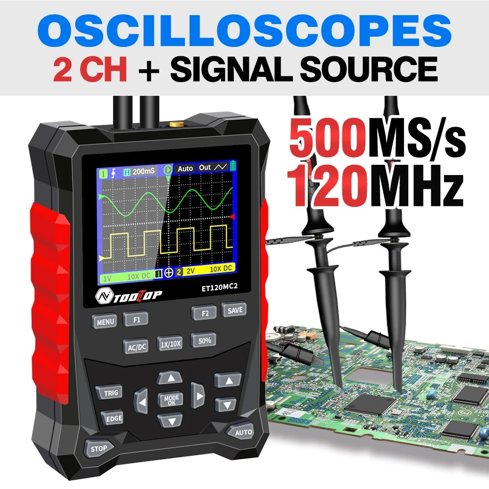
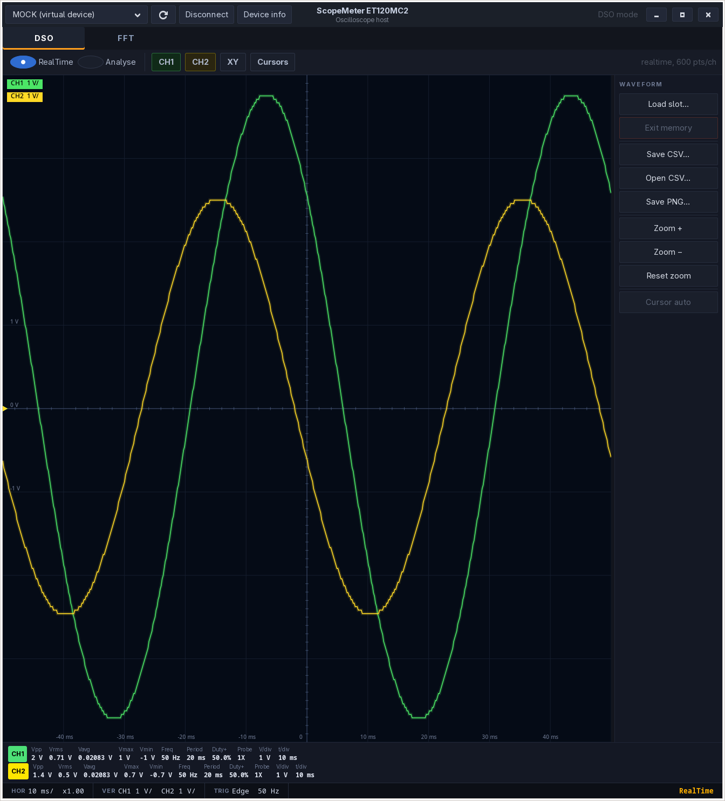
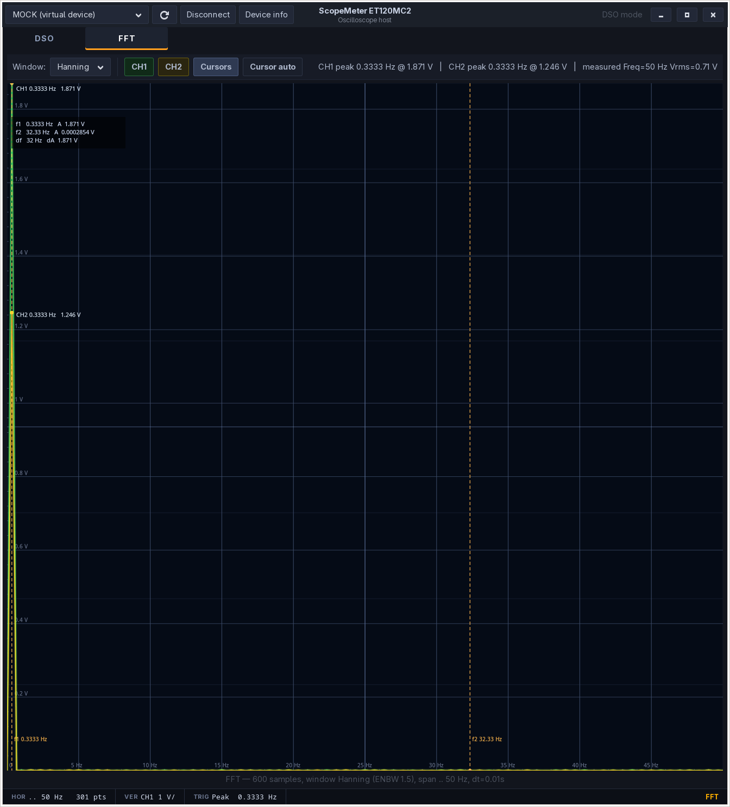
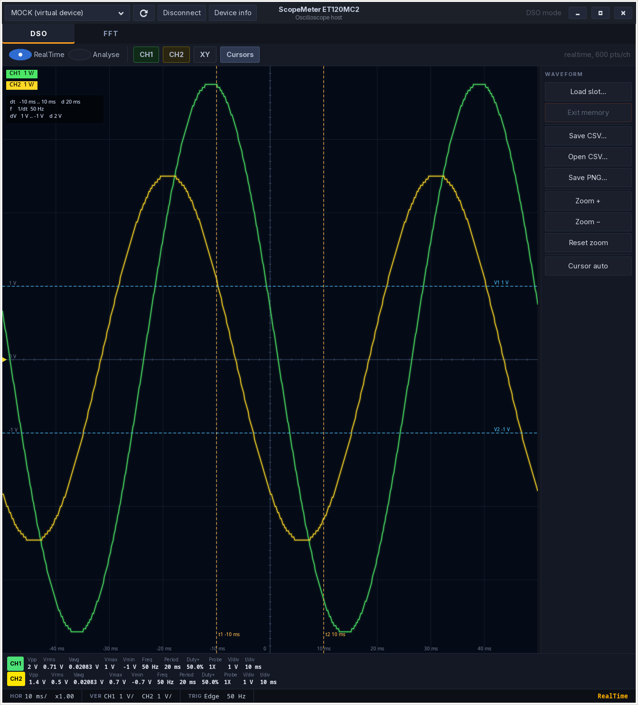
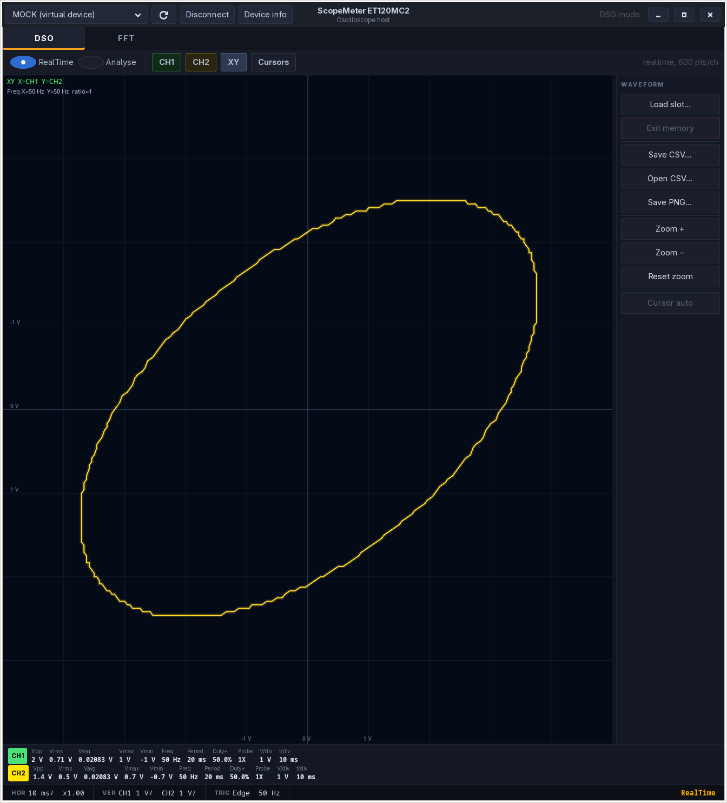
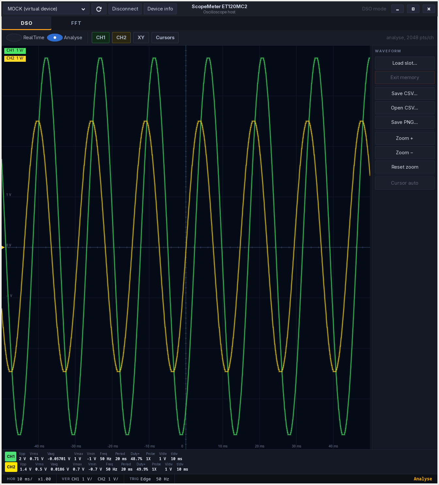
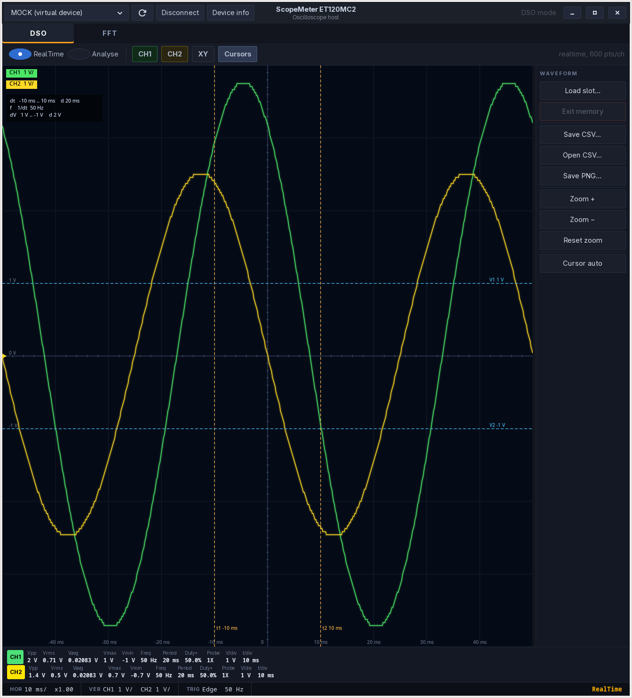

# ScopeMeter for Linux

Host application for the **TOOLTOP ET120MC2** oscilloscope.
A native port of the Windows ScopeMeter.exe (WinForms, .NET) to Python + GTK 3 + pyserial.

The USB CDC protocol (115200 8N1, sync `0xA5`) was reverse-engineered from the
binary — see [`docs/protocol.md`](docs/protocol.md).

[Українська версія README](README.ua.md)

## The device



**TOOLTOP ET120MC2** — handheld 2-channel oscilloscope + signal generator:
120 MHz (40 MHz with both channels), 500 MSa/s (equivalent), 320×240 screen,
up to 2500 saved waveforms, Li-ion battery.

Purchased here:
**[AliExpress — TOOLTOP ET120MC2 Dual Channel Digital Oscilloscope](https://s.click.aliexpress.com/e/_c3wwxn7F)**

## Features

- **DSO** — real-time and Analyse modes, two channels (CH1/CH2), measurements
  Vpp / Vrms / Vavg / Vmax / Vmin / Freq / Period / Duty+, time/div and V/div,
  probe attenuation (1X/10X), t/V cursors (Δt, ΔV) and XY mode (Lissajous).
- **FFT** — Rectangle, Hanning, Hamming, Blackman, FlatTop, Bartlett windows;
  CH1/CH2 channel chips (both spectra at once, same as in DSO),
  labeled grid (frequency / level), on-graph peak marker,
  f1/f2 cursors with Δf and levels, auto placement near the peak.
- **Waveform memory** — load waveform slots from device memory (DSO only),
  view, FFT analysis, Exit memory → back to RealTime.
- **CSV / PNG** — save and open waveforms, save PNG images.
- **Device info** — production info request (model, dates, HW/SW versions).
- Automatic device detection by VID `28E9` PID `018B` (GD32-CDC) and `2E88:4603`.
- **MOCK** mode with a virtual device — development and demos without hardware.

> ET120MC2 is a handheld oscilloscope + signal generator. The protocol is
> shared with the ET521A family, but the multimeter (DMM) function is not
> present in hardware and is disabled in this host. Parameter control
> (timebase, V/div, trigger, generator) stays on the device buttons —
> the host only reads data and states.

## Screenshots

| DSO | FFT |
|-----|-----|
|  |  |

| Cursors | XY |
|---------|----|
|  |  |

| Analyse | Active tab |
|---------|------------|
|  |  |

## Running

```sh
./run.sh                 # auto-detect the device
./run.sh --port /dev/ttyACM0
./run.sh --mock          # virtual device
./run.sh --selftest      # protocol check without GUI
./run.sh --list-ports    # list serial ports
```

Dependencies: Python 3.10+, `pyserial`, `PyGObject` (GTK 3), `numpy`.

```sh
pip install -r requirements.txt
# or from system packages: python3-gi gir1.2-gtk-3.0 python3-serial python3-numpy
```

## Port access

The device shows up as `/dev/ttyACM0`. udev rules:

```sh
sudo cp 99-scopemeter.rules /etc/udev/rules.d/
sudo udevadm control --reload-rules && sudo udevadm trigger
```

Verify:

```sh
./run.sh --list-ports     # should list the device with VID 28e9 / PID 018b
dmesg | tail              # appearance of /dev/ttyACM*
```

## Tests

```sh
python3 -m unittest discover -s tests
./run.sh --selftest
```

## Layout

```
scopemeter/
  protocol.py   0xA5 framing, command codes, time/voltage scales
  models.py     ChannelInfo, DsoFrame
  device.py     reader thread, poller, frame parser, auto-detect
  mock.py       virtual device (DSO + memory + production)
  config.py     settings persistence
  selftest.py   GUI-less protocol check
  ui/           GTK: app.py, dso_page.py, fft_page.py
tests/          unittest for protocol, device, fft/csv
docs/protocol.md  protocol description
images/         device photo
```
