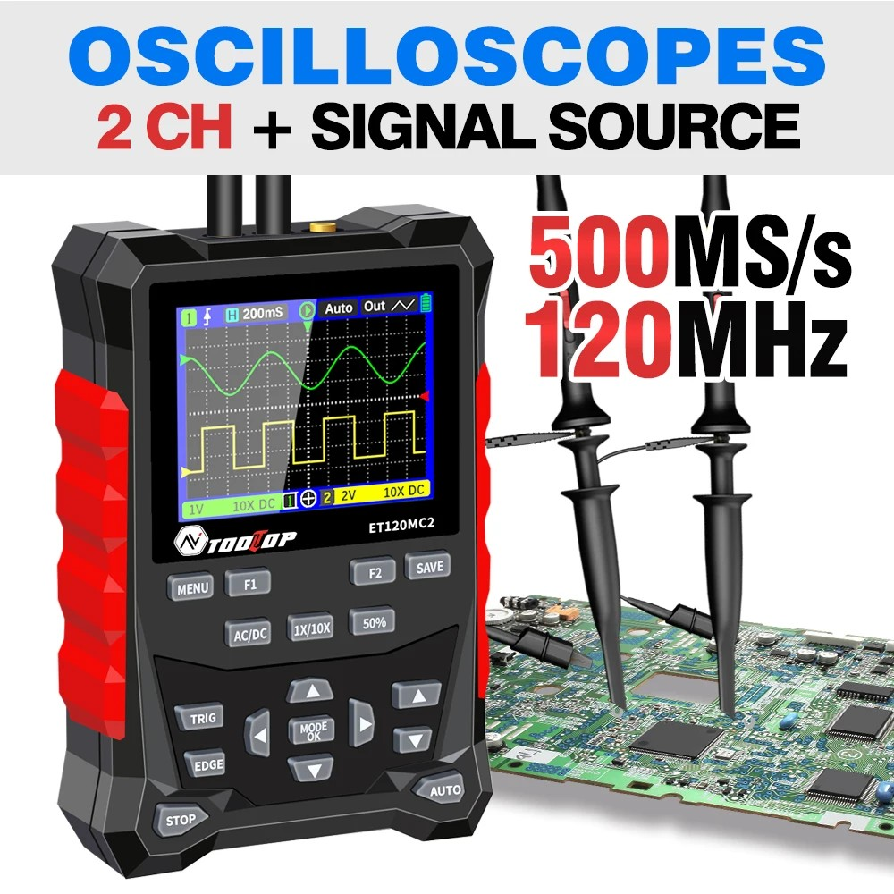
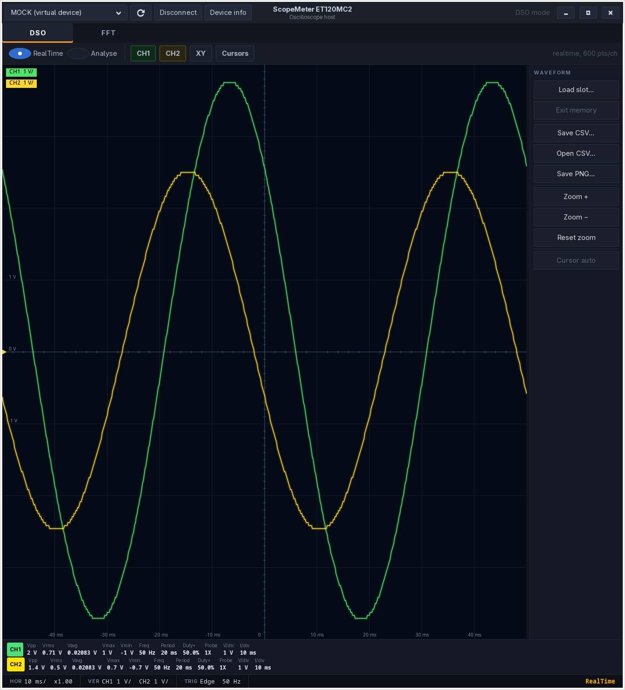
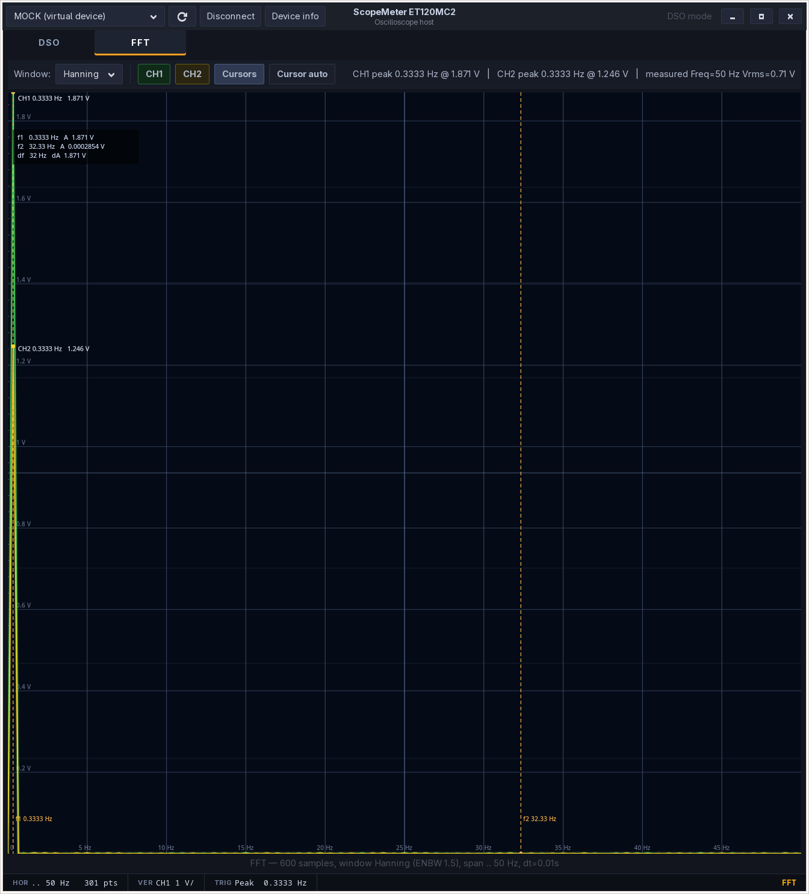
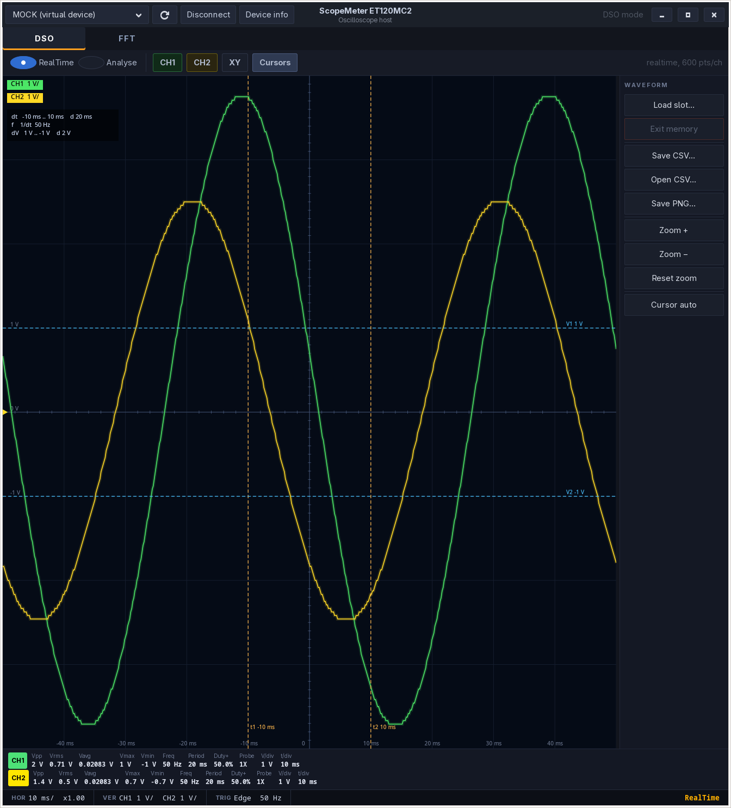
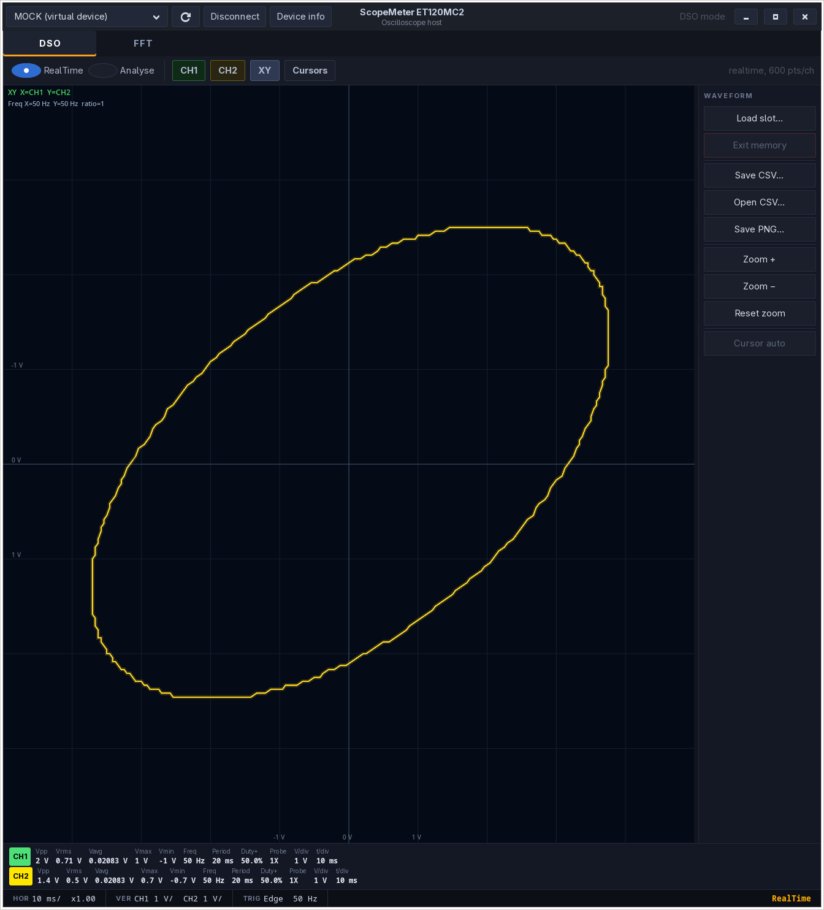
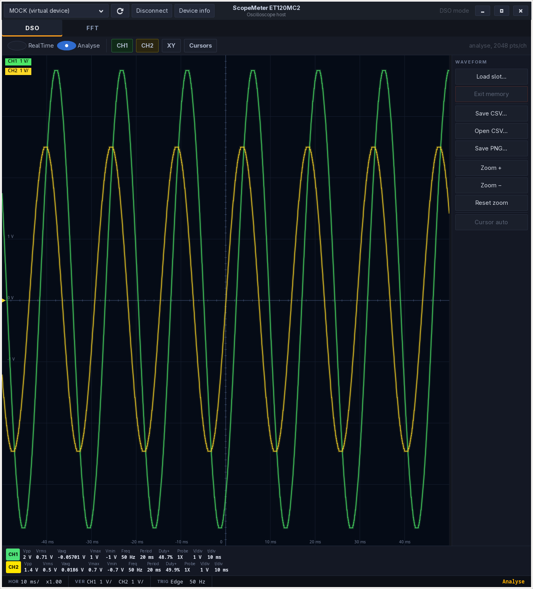
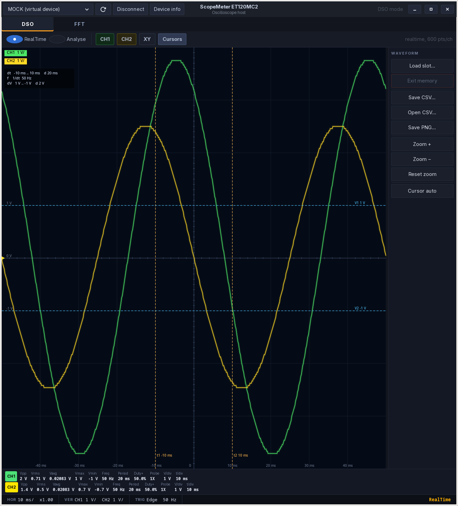

# ScopeMeter

Хост-застосунок для осцилографа **TOOLTOP ET120MC2**.
Нативний порт Windows-програми ScopeMeter.exe (WinForms, .NET) на Python + GTK 3 + pyserial.
Працює на Linux та Windows (MSYS2).

Протокол USB CDC (115200 8N1, sync `0xA5`) відтворено з бінарника — див.
[`docs/protocol.md`](docs/protocol.md).

## Пристрій



**TOOLTOP ET120MC2** — портативний 2-канальний осцилограф + генератор сигналу:
120 MHz (40 MHz на двох каналах), 500 MSa/s (еквівалентне), екран 320×240,
до 2500 збережених осцилограм, живлення від Li-ion.

Купував тут:
**[AliExpress — TOOLTOP ET120MC2 Dual Channel Digital Oscilloscope](https://s.click.aliexpress.com/e/_c3wwxn7F)**

## Можливості

- **DSO** — реальний час і режим Analyse, два канали (CH1/CH2), вимірювання
  Vpp / Vrms / Vavg / Vmax / Vmin / Freq / Period / Duty+, час/под і В/под,
  проба (1X/10X), курсори t/V (Δt, ΔV) та XY-режим (Lissajous).
- **FFT** — вікна Rectangle, Hanning, Hamming, Blackman, FlatTop, Bartlett;
  чипи вибору каналів CH1/CH2 (обидва спектри одночасно, як у DSO),
  підписана сітка (частота / рівень), маркер піку на графіку,
  курсори f1/f2 з Δf та рівнями, авторозстановка біля піку.
- **Waveform memory** — завантаження слотів з пам'яті пристрою (тільки DSO),
  перегляд, FFT-аналіз, Exit memory → повернення в RealTime.
- **CSV / PNG** — збереження та відкриття осцилограм, збереження PNG.
- **Device info** — запит виробничої інформації (модель, дата, HW/SW).
- Авто-детект пристрою за VID `28E9` PID `018B` (GD32-CDC) та `2E88:4603`.
- Режим **MOCK** з віртуальним пристроєм — для розробки та демо без апарата.

> ET120MC2 — портативний осцилограф + генератор сигналу. Протокол
> сумісний з родиною ET521A, але функція мультиметра (DMM) не реалізована
> апаратно і в цьому хості прибрана. Керування параметрами (часова база,
> V/div, тригер, генератор) залишається на кнопках самого приладу —
> хост лише читає дані та стани.

## Скріншоти

| DSO | FFT |
|-----|-----|
|  |  |

| Курсори | XY |
|---------|----|
|  |  |

| Analyse | Активна вкладка |
|---------|-----------------|
|  |  |

## Запуск

Linux:

```sh
./run.sh                 # авто-детект пристрою
./run.sh --port /dev/ttyACM0
./run.sh --mock          # віртуальний пристрій
./run.sh --selftest      # перевірка протоколу без GUI
./run.sh --list-ports    # список послідовних портів
```

Windows (див. нижче):

```bat
run.bat                  # авто-детект пристрою
run.bat --port COM5
run.bat --mock           # віртуальний пристрій
run.bat --selftest       # перевірка протоколу без GUI
run.bat --list-ports     # список послідовних портів
```

Залежності: Python 3.10+, `pyserial`, `PyGObject` (GTK 3), `numpy`.

```sh
pip install -r requirements.txt
# або з системних пакетів: python3-gi gir1.2-gtk-3.0 python3-serial python3-numpy
```

## Windows

GTK на Windows не ставиться через pip — найпростіший спосіб це **[MSYS2](https://www.msys2.org)**:

1. Встановіть MSYS2 з <https://www.msys2.org> (шлях за замовчуванням `C:\msys64`).
2. Відкрийте шел **MSYS2 MINGW64** та встановіть пакети:

   ```sh
   pacman -S mingw-w64-x86_64-python \
             mingw-w64-x86_64-python-gobject \
             mingw-w64-x86_64-python-pyserial \
             mingw-w64-x86_64-python-numpy
   ```

3. Запускайте з шелу MSYS2:

   ```sh
   python -m scopemeter             # авто-детект пристрою
   python -m scopemeter --port COM5
   python -m scopemeter --mock      # віртуальний пристрій
   python -m scopemeter --selftest  # перевірка протоколу без GUI
   python -m scopemeter --list-ports
   ```

   Або додайте `C:\msys64\mingw64\bin` у системний `PATH` Windows і
   запускайте `run.bat` з CMD / PowerShell.

Налаштування зберігаються в `%APPDATA%\scopemeter\scope.ini`.

### Доступ до порту (Windows)

Правила udev не потрібні: Windows сама завантажує вбудований драйвер
`usbser.sys` для USB CDC-пристрою і створює COM-порт автоматично.

Перевірити:

```bat
run.bat --list-ports     # має показати пристрій із VID 28e9 / PID 018b
```

або знайти пристрій у **Диспетчері пристроїв → Порти (COM і LPT)**.

Якщо COM-порт не з'явився:

- від'єднайте та підключіть пристрій знову, натисніть кнопку оновлення
  у заголовку вікна;
- у Диспетчері пристроїв виберіть невідомий пристрій → *Оновити драйвер*
  і дозвольте Windows шукати (пристрій є стандартним USB CDC/ACM);
- спробуйте інший USB-кабель/порт (кабелі лише для зарядки не мають
  дата-ліній).

## Доступ до порту (Linux)

Пристрій з'являється як `/dev/ttyACM0`. Правила udev:

```sh
sudo cp 99-scopemeter.rules /etc/udev/rules.d/
sudo udevadm control --reload-rules && sudo udevadm trigger
```

Перевірити:

```sh
./run.sh --list-ports     # має показати пристрій із VID 28e9 / PID 018b
dmesg | tail              # поява /dev/ttyACM*
```

## Тести

```sh
python3 -m unittest discover -s tests
./run.sh --selftest
```

## Структура

```
scopemeter/
  protocol.py   фреймінг 0xA5, коди команд, шкали часу/напруги
  models.py     ChannelInfo, DsoFrame
  device.py     потік читання, poller, парсер кадрів, авто-детект
  mock.py       віртуальний пристрій (DSO + memory + production)
  config.py     збереження налаштувань
  selftest.py   без GUI-перевірка протоколу
  ui/           GTK: app.py, dso_page.py, fft_page.py
tests/          unittest для protocol, device, fft/csv
docs/protocol.md  опис протоколу
images/         фото пристрою
```
